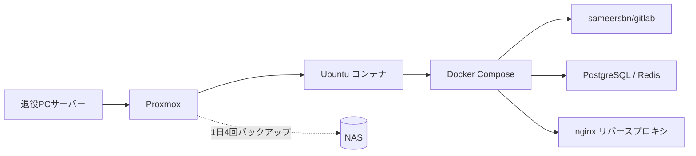
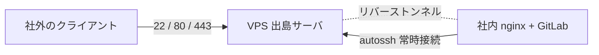

クラウドとSaaSがこれだけ充実した時代に、Gitホスティングを自社運用するのは時代に逆行しているように見えます。それでも弊社（アイデアマンズ）は、クライアントとのソースコード共有とWikiによるドキュメント共有のために、GitLabをセルフホスティングしています。

しかも、実質的なランニングコストは月500円程度です。この記事では、その動機と構成、運用上の判断を整理します。自社でGitホスティングを持つことを検討している方の材料になれば幸いです。

## なぜGitHubではなくGitLabなのか

理由は3つあります。

1つ目は共有のコストです。GitHubでは社外のコラボレーターをリポジトリに招待すると、その分が課金対象になると理解しています。プロジェクトによっては10人以上に共有することもあり、金額が膨らみます。これがセルフホスティングを選んだ一番の理由でした。

2つ目は非エンジニアのハードルです。ソースコードと同時にWikiのドキュメントも共有することが多いのですが、共有相手は必ずしもエンジニアではありません。アカウントを開設してもらう手間は想像以上に大きいものです。GitLabならこちらでアカウントを作成し、パスワードだけ設定してもらう運用ができます。

3つ目は日本語対応です。GitLabはGUIの大部分が日本語化されています。日本のクライアントにとっては親しみやすさが違います。

## どこで動かしているか

### 退役PCとProxmox

稼働場所は社内の「自称」データセンターです。退役したPCをサーバーに仕立て、通常のネット回線を使っているので、ランニングコストは実質的に電気代だけになります。

GitLabはかなりパワフルなRuby on Rails製アプリケーションで、快適に使うにはそれなりの性能が必要です。この退役PCサーバーの性能は、VPSなら月2〜3万円程度のプランに匹敵します。AWSやVPSで同じ性能を借りれば、相応の金額がかかります。

ベアメタルのLinuxへ直接インストールする運用はしていません。PCサーバーに[Proxmox](https://www.proxmox.com/en/)をインストールし、その上でコンテナとしてUbuntuを動かし、さらにDocker Composeでシステム群を稼働させています。

### バックアップは2層

Proxmoxは仮想化プラットフォームとしてよくできていて、バックアップ機能を標準で備えています。コンテナイメージを1日4回、NASへバックアップしています。ディスクイメージのスナップショットも簡単に取れるので、アップグレード作業も安心して進められます。

これとは別に、GitLab自身も高精度なアプリケーションバックアップ機構を持っています。OSイメージとアプリケーション、両方があると安心感が違います。

実際にこのバックアップに助けられた経験があります。稼働時間に応じてリソースが圧迫され、サービスが頻繁に停止する問題に見舞われたときです。最終的にGitLabをクリーンインストールし、アプリケーションバックアップから復元したところ、事態が解決しました。

### オールインワンのDockerイメージ

GitLabは複雑なRuby on Railsアプリケーションで、セットアップの難易度が高い部類です。以前、素直にインストールしようとして挫折したこともあります。

現在は[sameersbn/gitlab](https://hub.docker.com/r/sameersbn/gitlab/)を使っています。雛形の `docker-compose.yml` にPostgreSQLをはじめ必要なミドルウェアが記述済みで、`.env` に環境変数を指定するだけで自分用のGitLabが手に入ります。

メール送信は自社運用のハードルが高いため、外部サービスに任せています。弊社は全サービスを通して[SendGrid](https://sendgrid.com/en-us)を使っており、GitLabもその設定です。

### アップグレードはスナップショットとセットで

このDockerイメージは今のところ安定してバージョンアップに追従してくれています。数ヶ月に一度、アップグレードを行う運用です。

手順としては、Proxmox上でOSのイメージスナップショットを取り、アップグレードが済んだらスナップショットを統合します。たまにアップグレードを忘れ、バージョンを大きく跨いで失敗し、GitLabが起動しなくなることもあります。その場合もスナップショットをロールバックすれば元通りです。

:::message
GitLabには[アップグレードのバージョンパス専用ガイド](https://gitlab-com.gitlab.io/support/toolbox/upgrade-path/)があります。飛び級アップグレードに失敗したときは、このツールの世話になります。
:::

社内にはProxmoxが稼働しているサーバーが他にも数台あります。最悪、休眠中のPCにProxmoxをインストールすれば済みます。ハードウェア障害が起きても、OSのイメージバックアップから数十分程度で復旧できる想定です。

## どうやって社外へ公開しているか

社内で動かしているサーバーを、社外のクライアントからアクセスできるようにする必要があります。公開が必要なポートは3つです。

- SSH（22）: Git用
- HTTP（80）: HTTPSへのリダイレクト
- HTTPS（443）: Web GUI用

### lego + nginx + Route53 でSSL

sameersbn/gitlabが提供するのは素のHTTPなので、SSL化が必要です。

証明書はLet's EncryptのCLIクライアント[lego](https://github.com/go-acme/lego)で取得しています。legoはAWSのDNSサービスRoute53とAPI連携してドメインの所有権を証明し、証明書を発行・更新します。

その証明書を使うnginxをリバースプロキシとして置きます。Docker Hubの公式nginxイメージを、GitLabと同じ `docker-compose.yml` に追記するだけの構成です。

### 「出島サーバ」としてのVPS

GitLabとnginxは社内で動いているため、そのままでは外部から到達できません。そこで月500円程度の安いVPSを契約し、社内サーバーから[autossh](https://github.com/Autossh/autossh)で常時SSH接続して、ポート22・80・443をリバーストンネルで公開しています。

このVPSの使い方を、長崎の出島になぞらえて「出島サーバ」と呼んでいます。処理そのものは社内の性能の高いマシンが担い、外部に晒すのは安価なVPSだけ、という分担です。

:::message alert
ポート22のリバーストンネルは、出島サーバ自体のSSH接続と競合します。出島サーバ側のSSHポートを別の番号に変更しておく必要があります。
:::

## セルフホスティングは必要か

冒頭に書いたとおり、これは時代に逆行した選択だと考えています。「オープンソースだから自社運用すればほとんどタダ」と目論んでも、障害発生時のコストや経済損失を計算に入れると、毎月料金を払ったほうが結局は得になる場面が多いはずです。

それでも意味があると感じるのは、インフラのトレーニングになるからです。弊社でも簡単なサービスはFirebaseで提供し、止められないサービスはAWSをCDKで管理しています。便利になるほど、伝統的なサーバー構築のスキルを使う機会は減ります。クラウド時代だからネットワークやサーバーは分かりません、では技術的に脆くなります。普段使うサービスの一部を自分で立ててみることには、その意味での価値があります。

そしてもう1つ、安価にできるだけ安定運用するにはどうするかを調べて試すのは、単純に楽しい作業でもあります。

さらに詳しくは次の記事で解説しています。

- [GitLabセルフホスティングの話](https://notes.ideamans.com/posts/2024/gitlab-selfhost.html?utm_source=zenn&utm_medium=blog&utm_campaign=notes-digest)
