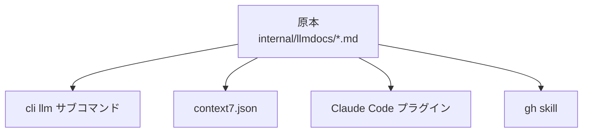

弊社（アイデアマンズ）では、AIエージェントに外部サービスを扱わせたいとき、そのAPIをGoでラップしたCLIを作ってエージェントに使わせています。

CLIを用意するところまでは早いのですが、エージェントはそのCLIの使い方を知りません。どのフラグを付ければJSONが返るのか、どの値を読み違えやすいのかを、何らかの形で渡す必要があります。

渡す経路はいくつもあります。CLI自身にLLM向けのヘルプを持たせる、Claude Codeのプラグインにする、`gh skill` に対応する、などです。ただ、どの経路でも伝えたい中身は同じで、違うのはフォーマットと見せ方だけでした。

そこで、原本を1か所に置いて各形式へ派生させるツールキット [go-llm-cli-kit](https://github.com/ideamans/go-llm-cli-kit)（MITライセンス）を作り、社内のGo製CLI15本に組み込みました。この記事では、その過程で決めたことを設計判断として整理します。

## 4つの形式と、それぞれが届く先

原本はリポジトリ内の `internal/llmdocs/*.md` です。ここから4つの形式を派生させます。



形式によって届くエージェントと前提条件が違います。

| 形式 | 届くエージェント | 前提 |
|---|---|---|
| `<cli> llm` | ローカルでCLIを実行できる全エージェント | バイナリのみ |
| context7 | context7 MCPを繋いだエージェント | publicリポジトリのみ |
| Claude Codeプラグイン | Claude Code | マーケットプレイス登録 |
| `gh skill` | Copilot / Cursor / Gemini CLI / Codex など | `gh` v2.90.0以降 |

1つの形式だけでは届かない相手が出ます。privateリポジトリのCLIはcontext7に載りませんし、`gh skill` は `gh` のバージョンに依存します。そこで4つとも同じ原本から出すことにしました。

Goのパッケージは4つで、依存はcobraだけです。

- `llmdocs`：embedしたMarkdownの章を名前順に結合し、MarkdownまたはJSONで返す
- `catalog`：cobraのコマンドツリーからコマンドカタログを生成する
- `llmcmd`：標準の `llm` サブコマンドを足す
- `skillcheck`：配布用のSKILL.mdとplugin.jsonを検証する

## 原本はファイル名の番号で章立てする

原本のMarkdownは、ファイル名の数値プレフィックスで章の順番を決めています。

| 範囲 | 用途 | 書き方 |
|---|---|---|
| `00-guide.md` | 鉄則・認証・代表ワークフロー・失敗モード | 手書き |
| `10-` 〜 `89-` | トピック章 | 手書き |
| `90-commands.md` | コマンドカタログ | 生成 |

`00-guide.md` は人間向けのREADMEとは別物として書きます。先頭には、エージェントがいちばん間違えやすいことを鉄則として置きます。たとえば「パースするなら必ず `-f json` を付ける」「値が `0` のときはデータ不足の意味であることが多い」といった内容です。章の後半には失敗モードの表を置き、症状・原因・取るべき対処を並べます。

## `<cli> llm` なら説明と実行中のバージョンがずれない

CLI側の組み込みは2か所です。まず章をバイナリに埋め込みます。

```go:internal/llmdocs/llmdocs.go
package llmdocs

import (
	"embed"

	kit "github.com/ideamans/go-llm-cli-kit/llmdocs"
)

//go:generate go run ../gen-llmdocs

//go:embed *.md
var files embed.FS

func Docs() *kit.Docs { return kit.New(files, ".") }
```

次にサブコマンドを足します。

```go:main.go
cfg := llmcmd.Config{Docs: llmdocs.Docs()}
llmcmd.AddTo(root, cfg)
```

これで `<cli> llm`（Markdown）と `<cli> llm --format json`（章ごとのJSON配列）が使えるようになります。

ナレッジがバイナリに入っているので、実行中のバージョンと説明が必ず一致します。ドキュメントサイトのように古くなる心配がなく、ネットワークも要りません。

ツールキットを作る前のCLIには `--llm` フラグがあり、`<cli> device --llm` のようにコマンドラインのどの位置に書いても動いていました。これを壊すと既存の利用が止まるので、`llmcmd.HandleLegacy` で後方互換を残しています。

## 生成するのはコマンドカタログだけにした

当初はSKILL.mdやcontext7のルールも生成する計画でした。実装してみると、手書きのほうがよいものになりました。

どちらも読み物で、どの落とし穴を書くかを選ぶのは人間の判断です。機械的に導けるのは、コマンドとフラグの一覧に限られていました。

そこで生成器はコマンドカタログの1本に絞り、cobraのコマンドツリーをそのままMarkdownにしています。

```go
md := catalog.Markdown(cmd.Root(), catalog.Options{
	Title: "Command catalog",
	Skip:  []string{"llm"},
})
os.WriteFile("90-commands.md", []byte(md), 0o644)
```

## 生成物を追跡するならCIで差分を見る

`go:embed` はビルド時に実ファイルを要求するので、`90-commands.md` はgitで追跡せざるを得ません。追跡すると、コマンド定義だけ直してカタログの再生成を忘れたコミットが起こりえます。

そこでCIで再生成し、差分が出たら落とします。

```yaml
- run: go generate ./...
- run: git diff --exit-code
- run: go test ./...
```

同じ目的でも、TypeScript製の自社OSSでは生成物を追跡しない方針にしています。ビルドのたびに生成するので、ズレた状態のコミットが構造的に起きないからです。

追跡するかしないかの判断は正反対ですが、どちらもズレをmainに入れないための選択です。避けるべきなのは、追跡しているのにCIで検査しない形です。

## SKILL.mdはAgent Skillsの標準フィールドだけで書く

配布するスキルのfrontmatterには、Agent Skillsの標準フィールドだけを使っています。

| フィールド | 必須 | 書くこと |
|---|---|---|
| `name` | Yes | 1〜64文字のkebab-case。親ディレクトリ名と一致させる |
| `description` | Yes | 「何をする」と「いつ使う」の両方。エージェントはここを見て起動を判断する |
| `license` | No | ライセンス |
| `compatibility` | No | 環境要件。バイナリの所在や必要な資格情報 |
| `allowed-tools` | No | 実験的だが各社が尊重する |
| `metadata` | No | Claude固有の挙動は `metadata.claude-code.*` へ逃がす |

`argument-hint` や `paths` や `model` はClaude Codeの拡張で、他のエージェントでは無視されます。標準フィールドに絞れば、Claude・Copilot・Cursor・Gemini CLI・Codexのどれでも同じファイルを読めます。

拡張フィールドが紛れ込むと他のエージェントで意図どおりに動かないので、`skillcheck` で検出して `go test` を失敗させています。

```go:cmd/mycli/plugin_test.go
func TestPluginSkills(t *testing.T) {
	report := skillcheck.CheckDir("plugins/mycli", skillcheck.Options{
		Version:             version,
		Keywords:            []string{"mycli"},
		RequireInstallSkill: true,
	})
	for _, p := range report.Problems {
		t.Error(p)
	}
}
```

なお、ローカル用の `.claude/skills/` はこの検証の対象外で、Claudeの拡張を自由に使っています。

スキルの本文はマニュアルにせず、手順だけを書きます。まずバイナリの有無を確かめ、次に `<cli> llm` を読ませる。マニュアル本体は `<cli> llm` が持っているので、本文はその段取りだけで足ります。

## installスキルを必ず1本添える

配布するスキルは最低2本にしています。CLIで仕事をする `<cli>-usage` と、導入と更新を担う `<cli>-install` です。

`-install` を足したのは、インストール方法を人間が調べて実行するのが面倒だったからです。スキルを入れても、バイナリがPATHに無ければそこで止まります。そのたびにREADMEとリリースページを見て、置き場所を自分で決めることになります。「CLIが無ければついでに入れておいて」と頼めば済む状態にしたかったので、`RequireInstallSkill` で必須にしました。

導入の経路は優先順を固定しています。

1. PATHにある既存バイナリを使う（最新版かどうかは確認しない）
2. GitHub Releasesから取得する（publicは `curl`、privateは `gh release download`）
3. ソースからビルドする（Goツールチェインが要るので最下位）

`sudo` の実行とシェルプロファイルの編集は、エージェントの判断に任せずユーザーへ委ねています。

## 原本そのものの更新漏れは誰にも検出できない

ここまでの仕組みが保証するのは、原本を直せば派生物が追随することまでです。原本自体の更新漏れは検出できません。フラグを1つ足したときに `00-guide.md` の鉄則を書き足すかどうかは、人間とエージェントの判断に残ります。

ドキュメントやヘルプが古ければ、人間が読んで気づきます。LLM向けのナレッジが古い場合は、エージェントが黙って間違えるだけです。症状は「なぜかうまく使えない」という形でしか出てきません。

弊社では各CLIのCLAUDE.mdに、変更時に直す先を表で書いています。①ドキュメント ②ヘルプ ③LLM向けナレッジの3か所です。

## まとめ

- AIエージェントへの渡し方は複数あるが、配る知識は1つなので原本も1か所に置く
- 生成するのはコマンドカタログだけにし、鉄則や落とし穴は手書きする
- 生成物をgitで追跡するなら、CIで再生成して差分を検査する
- 配布するSKILL.mdはAgent Skillsの標準フィールドに絞り、テストで検証する
- 原本の更新漏れは仕組みでは止められないので、変更時の手順をCLAUDE.mdに書いておく

さらに詳しくは次の記事にまとめています。

- [Go言語製CLIのAI向けナレッジをワンソースで複数の形式に展開するためのOSSライブラリ go-llm-cli-kit](https://notes.ideamans.com/posts/2026/go-llm-cli-kit.html?utm_source=zenn&utm_medium=blog&utm_campaign=notes-digest)
